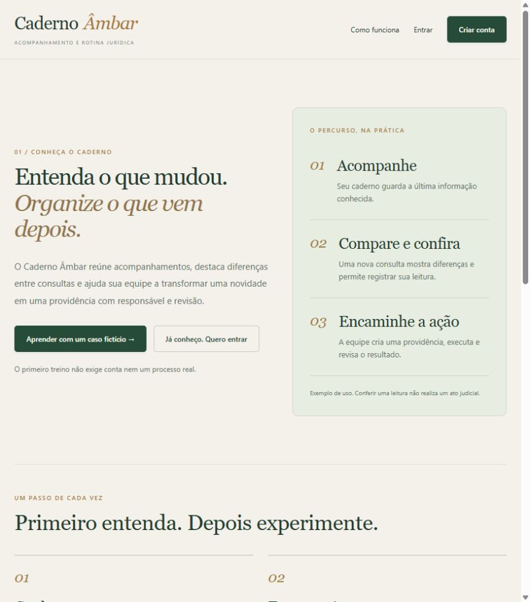
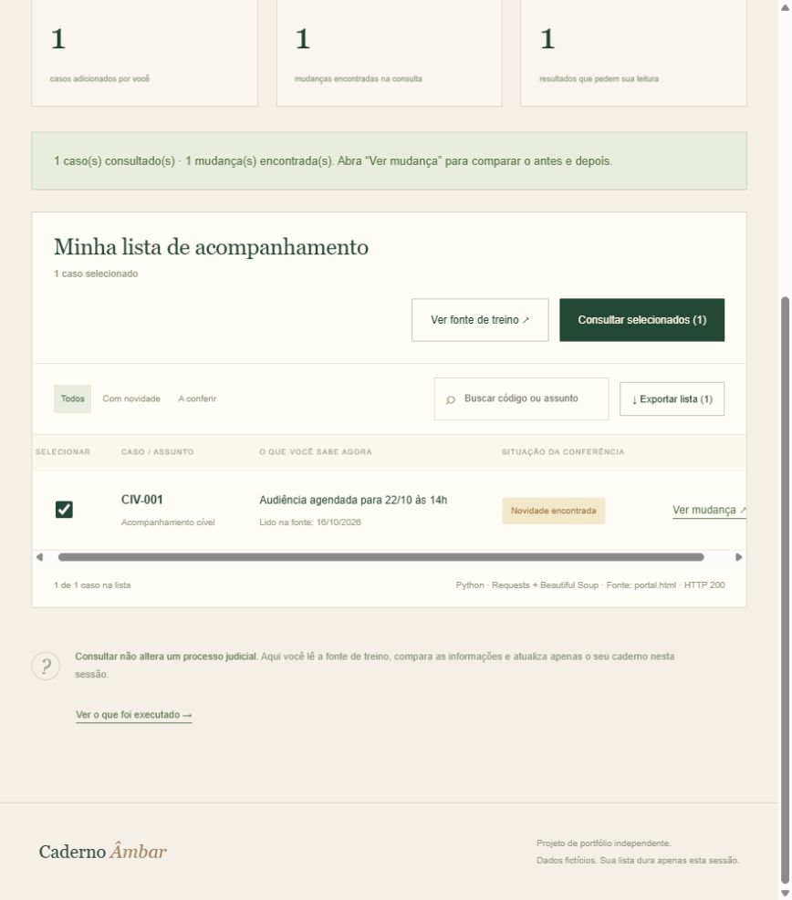
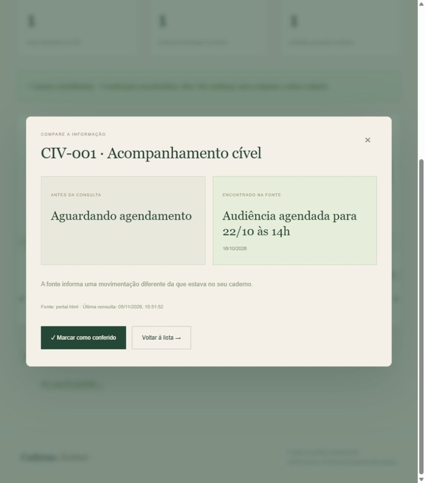
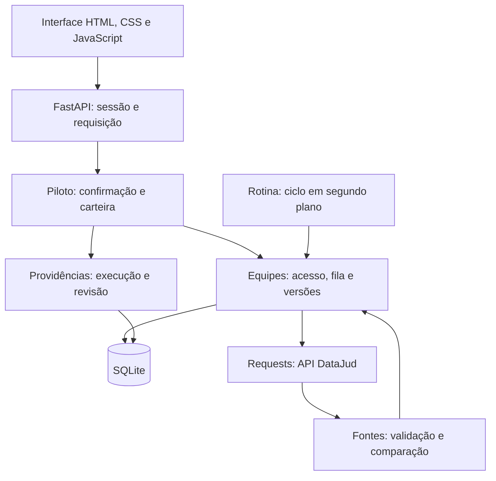

<div align="center">

# Caderno Âmbar

**Da consulta à próxima ação.**

Acompanhamento de processos, comparação de informações e organização do trabalho de uma equipe jurídica.


[Proposta](#a-proposta) · [Telas](#o-aplicativo-em-imagens) · [Executar](#executar-localmente) · [Documentação](documentacao/README.md)

</div>



> **Projeto de portfólio em desenvolvimento.** Há aplicação local, persistência e testes. A consulta DataJud foi exercitada com dados públicos, mas sua disponibilidade oscila. O produto ainda não foi homologado para operação empresarial sem acompanhamento.

## A proposta

Consultar uma informação não encerra o trabalho: alguém precisa perceber a mudança, conferir a fonte e decidir o que fazer depois.

O Caderno Âmbar organiza esse percurso. Guarda a última referência recebida, identifica diferenças entre consultas e permite transformar uma novidade em uma providência com responsável, evidência e revisão.

O projeto começou como um laboratório para aprender **Python e automação**, explorando organização de informações no contexto jurídico. Evoluiu para uma aplicação com API, banco local, separação de escritórios, histórico e tarefas da equipe.

**Consultar → comparar → conferir → encaminhar → revisar.** A interpretação jurídica e a decisão permanecem humanas.

## O aplicativo em imagens

Capturas reais do laboratório local com **casos fictícios**, sem expor contas, processos reais ou credenciais. O treino funciona sem conta; a carteira persistente exige autenticação e utiliza o backend Python.

| Consulta da fonte de treino | Comparação antes e depois |
| --- | --- |
|  |  |

## O que foi implementado

| Área | Comportamento atual |
| --- | --- |
| Aprendizado | Apresentação, treino sem conta, tutoriais e percurso de cadastro e acesso. |
| Autenticação | Hash de senha com salt, sessões com expiração, confirmação de e-mail e recuperação de acesso. |
| Escritórios | Participantes, papéis de administrador/membro, convites e autorização no backend. |
| Carteira | Cadastro de processos, responsável, etiquetas, busca, filtros, paginação no banco e arquivamento. |
| Consulta | Validação do número CNJ, fontes demonstrativas separadas das reais e consulta JSON ao DataJud. |
| Histórico | Tentativas, versões, comparação de movimentos por grau, conferências e auditoria. |
| Providências | Atividade vinculada ao processo ou à versão, responsável, revisor, comentários, evidência e estados. |
| Atualização | Fila persistente, reserva de execução, espera crescente, tentativas limitadas e preservação da referência anterior. |
| Dados | Importação CSV com prévia, exportação da carteira e exportação administrativa do escritório. |
| Operação | Caixa de e-mail local, SMTP configurável, backup consistente e configuração de implantação. |

Uma **consulta** registra uma tentativa; uma **versão** guarda conteúdo recebido; uma **providência** representa trabalho da equipe. Uma tentativa com erro não cria dados fictícios nem apaga a versão válida.

## Tecnologias e como são utilizadas

| Tecnologia | Uso concreto |
| --- | --- |
| **Python** | Regras, validação, comunicação HTTP, comparação, persistência e filas. |
| **FastAPI + Uvicorn** | API HTTP, middleware, respostas e execução do servidor local. |
| **SQLite + SQL** | Contas, sessões, escritórios, processos, versões e atividades, com `sqlite3` e valores parametrizados. |
| **Requests** | Busca HTML da fonte de treino e faz chamadas à API pública do DataJud. |
| **Beautiful Soup** | Extrai campos do HTML no laboratório; não é necessário para ler o JSON do DataJud. |
| **Playwright** | Roteiro de operação e verificação da interface do laboratório em Chromium. |
| **HTML, CSS e JavaScript** | Interface sem etapa de build, formulários, tutoriais e chamadas à API. |
| **unittest** | Testes Python de regras, HTTP local, SQLite temporário, permissões e falhas simuladas. |
| **Node.js + jsdom** | Testes da interface em DOM simulado, separados do roteiro Playwright. |
| **ReportLab** | Geração do manual PDF; ferramenta de documentação, não dependência do servidor. |

```text
LABORATÓRIO: Requests obtém HTML → Beautiful Soup extrai → Python compara
FONTE REAL: Requests chama DataJud → Python valida JSON → compara → SQLite guarda
NAVEGADOR: Playwright abre o laboratório → preenche e clica → verifica a interface
```

As ferramentas não são executadas juntas em toda operação. O roteiro Playwright não faz o transporte da consulta real ao tribunal.

## Arquitetura do fluxo atual



`Piloto` herda de `Escritorio`, que herda de `Equipes` e de `Caderno`. A aplicação cria um serviço na inicialização; as conexões SQLite são abertas e fechadas por operação.

## Integração DataJud: resultados e limites

A fonte real é a **API pública do Conselho Nacional de Justiça — DataJud**, que fornece metadados de processos públicos, sem acesso automático aos autos integrais.

No ensaio de 04/11/2026, uma consulta autenticada pelo aplicativo recebeu 35 movimentos e persistiu uma versão com histórico e autoria. Em comparação controlada posterior, o corpo usado pelo app recebeu 38 movimentos; esse segundo resultado foi diagnóstico, sem importação como versão na carteira.

Também foi capturada uma recusa da própria consulta mínima oficial: **HTTP 429 com `es_rejected_execution_exception`**, indicando saturação da fila de buscas do fornecedor. O cliente reconhece causas internas, preserva os dados e controla novas tentativas. Sobrecarga recebe pausa mínima de cinco minutos; após cinco falhas consecutivas, o ciclo automático pausa.

**Uma chamada bem-sucedida não garante disponibilidade contínua.** HTTP 202 significa solicitação aceita na fila, não sucesso da consulta externa.

- [Causa observada e comparação com o exemplo oficial](documentacao/causa-confirmada-datajud.md)
- [Fila e experiência durante indisponibilidade](documentacao/fila-atualizacoes-datajud.md)
- [API pública: documentação oficial](https://datajud-wiki.cnj.jus.br/api-publica/)

## Executar localmente

Requer Python compatível com `requirements.txt`; o ambiente de desenvolvimento foi validado com **Python 3.15**. Node.js/npm são necessários para os testes JavaScript. O roteiro Playwright requer instalar o Chromium.

### Windows / PowerShell

```powershell
git clone https://github.com/atlasaqui/caderno-ambar.git
cd caderno-ambar
py -m venv .venv
.\.venv\Scripts\python.exe -m pip install -r requirements.txt
.\.venv\Scripts\python.exe backend\aplicacao.py
```

Abra **http://127.0.0.1:8093/index.html**. `INICIAR.cmd` automatiza a preparação e a execução local. Não é necessário ativar a `.venv` para usar os comandos acima.

### Linux / macOS

```bash
git clone https://github.com/atlasaqui/caderno-ambar.git
cd caderno-ambar
python3 -m venv .venv
.venv/bin/python -m pip install -r requirements.txt
.venv/bin/python backend/aplicacao.py
```

### Primeiro percurso

1. Abra **Aprender com um caso fictício**. O treino não consulta tribunais.
2. Adicione um exemplo, selecione, consulte e abra a comparação.
3. Para a carteira persistente, crie sua conta e entre em `acompanhamento.html`.
4. Em desenvolvimento, mensagens de confirmação ficam em `output/email-local/`, sem envio externo.
5. Use a demonstração do escritório para estudar versões e providências antes da fonte real.

Se a porta estiver ocupada, utilize a execução existente ou escolha outra antes de iniciar:

```powershell
$env:AMBAR_PORT = "8094"
.\.venv\Scripts\python.exe backend\aplicacao.py
```

### Configurar a fonte real

[.env.example](.env.example) documenta as variáveis. **Não é carregado automaticamente**, nem um `.env` criado por cópia. Configure o terminal ou o serviço de hospedagem.

No mesmo PowerShell que iniciará a aplicação:

```powershell
$env:AMBAR_DATAJUD_HABILITADO = "1"
$env:DATAJUD_API_KEY = Read-Host "Cole a chave pública vigente do CNJ"
.\.venv\Scripts\python.exe backend\aplicacao.py
```

Obtenha a chave na [página oficial de acesso](https://datajud-wiki.cnj.jus.br/api-publica/acesso/). A consulta exige conta confirmada, fonte configurada e finalidade adequada. Os tribunais permitidos atualmente são TJPE, TRT6 e TRF5.

`AMBAR_WORKER=0` desativa os ciclos. O servidor com worker ativo precisa permanecer ligado para executar a fila. Não inicie vários workers sem planejar a operação.

## Testes

Com as dependências Python instaladas, execute na raiz:

```powershell
.\.venv\Scripts\python.exe -m unittest discover -s backend -v
npm ci
npm run test:ui
```

Validação registrada: **56 testes Python e 16 testes JavaScript aprovados**. Incluem HTTP local autenticado, SQLite temporário, isolamento, revisão, fila durável, limites e falhas externas simuladas.

Mocks não comprovam disponibilidade do DataJud. jsdom não comprova layout nem acessibilidade em navegador. Veja as evidências por etapa em [Testes e validação](documentacao/testes-e-validacao.md).

<details>
<summary>Executar o roteiro Playwright do laboratório</summary>

```powershell
.\.venv\Scripts\python.exe -m playwright install chromium
.\.venv\Scripts\python.exe backend\rpa_navegador.py --visivel
```

O roteiro inicia seu servidor de treino e opera o laboratório. As evidências ficam em `output/rpa/`. A existência desse roteiro não significa que todos os fluxos atuais de equipes tenham sido validados por ele.

</details>

## Organização do código

```text
├── frontend/                 # Apresentação, treino, acesso e área de trabalho
├── backend/
│   ├── aplicacao.py          # Entrada recomendada: FastAPI e servidor atual
│   ├── piloto.py             # Carteira, confirmação e regras adicionais
│   ├── equipes.py            # Escritórios, consultas, versões e auditoria
│   ├── rotina.py             # Providências, revisão e processamento das filas
│   ├── acompanhamento.py     # Persistência básica, sessão e transporte DataJud
│   ├── fontes.py             # Validação, normalização, comparação e fontes
│   ├── consulta.py           # Laboratório HTTP + extração HTML
│   ├── rpa_navegador.py      # Roteiro Playwright do laboratório
│   ├── correio.py            # Caixa local e SMTP
│   ├── backup.py             # Cópia consistente e verificação do banco
│   ├── servidor.py           # Servidor legado do laboratório
│   └── test_*.py             # Testes Python
├── tests/                    # Testes JavaScript em DOM simulado
├── documentacao/             # Guias, arquitetura e evidências
│   ├── imagens/              # Capturas públicas com dados fictícios
│   └── para-leitura/         # Manual PDF e HTML navegável
├── ferramentas/              # Geração do manual e mapa do código
├── INICIAR.cmd               # Lançador local Windows
├── .env.example              # Configurações esperadas, sem credenciais
└── output/                   # Gerado localmente; não versionado
```

`backend/aplicacao.py` é o servidor atual, na porta 8093. `backend/servidor.py` e o lançador `backend/iniciar_datajud.py` pertencem ao fluxo legado, normalmente na porta 8092.

## Documentação para explorar o projeto

- [Índice e ordem de leitura](documentacao/README.md)
- [Estado atual e pendências](documentacao/estado-atual-do-projeto.md)
- [Mapa dos arquivos, classes e funções](documentacao/mapa-do-codigo.md)
- [Manual de estudo](documentacao/manual-completo.md) · [PDF](documentacao/para-leitura/Caderno-Ambar-Manual-Completo.pdf) · [HTML navegável](documentacao/para-leitura/Caderno-Ambar-Manual-Completo.html)
- [Fluxo das telas](documentacao/fluxo-das-telas.md)
- [Equipes e API](documentacao/guia-de-equipes.md)
- [Providências e revisão](documentacao/guia-de-providencias.md)

Os documentos registram etapas de desenvolvimento. Datas e contagens antigas são históricas; consulte o estado atual e o relatório de testes para conhecer o alcance validado.

## Em desenvolvimento

Ainda precisam de validação ou implementação: piloto com carteira autorizada, hospedagem e monitoramento, SMTP real, HTTPS público, backup externo e restauração operacional, MFA, política efetiva de retenção/exclusão e cobertura completa de acessibilidade e dispositivos. A receita Docker exige build e validação no destino.

O projeto não realiza peticionamento, consulta integral dos autos, cálculo automático de prazo jurídico nem integração de intimações oficiais.

`vercel.json` publica o conteúdo estático de `frontend/`. Isso não coloca automaticamente o backend Python persistente e o SQLite no ar. O funcionamento completo descrito aqui é local; uma implantação pública precisa hospedar API e armazenamento de forma compatível.

## Dados e autoria

Credenciais locais, sessões, tokens, mensagens, bancos, backups, pacotes instalados e diagnósticos de execução não fazem parte do repositório. Cada pessoa cria sua conta ao executar o projeto. As capturas deste README utilizam dados fictícios.

**Victor Monteiro** · Projeto independente de portfólio e aprendizagem.

Não é um produto oficial do CNJ nem implica vínculo com tribunal ou escritório. A fonte dos metadados reais é o **Conselho Nacional de Justiça / DataJud**, sujeita às condições de uso do fornecedor.
